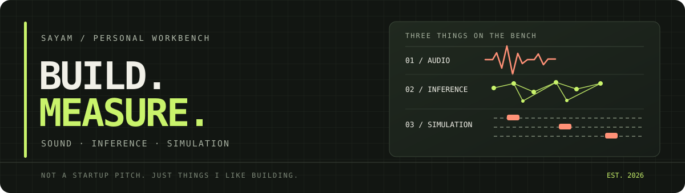

  
  

    
    
    
  

Maths student from India. I build apps, poke at inference speed, and write simulations when I can't settle an argument in my head.

Lately I've been splitting time between an offline audio app, patches to a Rust inference engine, and a traffic simulator that suggests "smart" drivers aren't always smart.

## Things I've built

<table>
  <tr>
    <td width="50%" valign="top">
      
      <h3><a href="https://github.com/sayampy/deepdenoiser">DeepDenoiser</a></h3>
      An Android app for cleaning up noisy audio and video. Runs on-device. No account, no upload, no cloud bill.
        
      React Native · Expo · Kotlin · ONNX Runtime
       
      <a href="https://play.google.com/store/apps/details?id=com.sayampy.deepdenoiser">Google Play</a> · <a href="https://github.com/sayampy/deepdenoiser/releases">Releases</a>
    </td>
    <td width="50%" valign="top">
      
      <h3><a href="https://github.com/sayampy/traffic-jam-analyze">Traffic Jam Simulator</a></h3>
      A little highway model comparing different driver behaviours. Turns out, constantly trying to get ahead can make everyone slower.
        
      Python · Pygame · Game theory
       
      <a href="https://github.com/sayampy/traffic-jam-analyze">See the experiments</a>
    </td>
  </tr>
</table>

**Old side quest:** [Football RL](https://github.com/sayampy/-Buggy-Football-RL), where I played with DQN agents and a game environment. It is very much an experiment, not a finished game.

## RustingStrata patches

Most of my recent open-source work has gone into [RustingStrata](https://github.com/RustingStudio/RustingStrata). I got interested because running MoE models on limited VRAM is full of awkward edge cases. These are the bits I've been working on:

| PR | Status | The change |
|---|---|---|
| [#74](https://github.com/RustingStudio/RustingStrata/pull/74) |  | Inkling 2 host fallback when experts don't fit in VRAM, adaptive GPU staging, and suffix drafts by default. In my test runs, decode moved from **8.6 to 16.3 tok/s** on Inkling 2 and **16.1 to 26.7 tok/s** on Tiel Coder. |
| [#80](https://github.com/RustingStudio/RustingStrata/pull/80) |  | Batched CPU-side expert matvecs. Around **25-36% faster decode** in the natural-prompt tests, with identical output in the correctness checks. |
| [#84](https://github.com/RustingStudio/RustingStrata/pull/84) |  | TurboQuant KV cache for CUDA, using Walsh-Hadamard transforms and Lloyd-Max quantization. Adds separate K/V formats and a much smaller cache representation. |
| [#89](https://github.com/RustingStudio/RustingStrata/pull/89) |  | Adds speculative draft counts to benchmark JSON, so scripts can see how many drafts were made and accepted. |

I also prototyped a budgeted calibration search balancing prefill, decode, and time-to-first-token in [#87](https://github.com/RustingStudio/RustingStrata/pull/87). That PR was closed without merging.

Speed figures are from the specific hardware, models, and prompts documented in the PRs. They aren't universal benchmark claims.

## A few tools on my desk

  

Python is where most experiments start. Rust has been taking up more of my time lately. TypeScript and Kotlin get the apps out of the door.

## The bench queue

Got a model, quantization method, or weird slowdown you'd like me to test? **Send me a bench request.** Pick a topic and leave a short explanation. I may turn a good one into the next experiment.

  
   
  <a href="https://github.com/sayampy/sayampy/issues?q=is%3Aissue">Browse suggestions and join the discussion</a>

## GitHub, lately

  
  
  

---

  If you found a bug, have a better benchmark, or just want to talk shop, my issues are open.
   
  <a href="https://github.com/sayampy">GitHub</a> · <a href="https://ko-fi.com/sayampy">Ko-fi</a>

